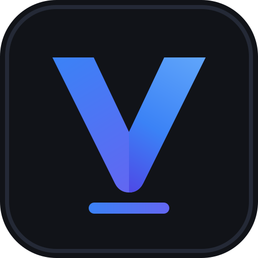

<p align="center">
  
</p>

<h1 align="center">VeloDeck · 极控</h1>

<p align="center">
  <strong>自托管 7×24 无人值守低延迟 Android 远程控制平台（60fps 硬编 · 跨网 P2P/TURN · 伪装黑屏 · WebRTC 文件直传与远程 OTA）</strong>
</p>

<p align="center">
  <em>Self-hosted, 24/7 unattended, low-latency Android remote control platform — 60fps hardware H.264 streaming, P2P/TURN NAT traversal, stealth black screen, WebRTC direct file transfer, and remote OTA updates.</em>
</p>

- Repository: <https://github.com/matrevi/velodeck>
- **Fork 与自托管完整部署指南**：[docs/SELF_HOSTING.md](docs/SELF_HOSTING.md)（含 Docker 域名/纯 IP 方案、GitHub Actions 零环境云端编译专属 APK、应用内自更新与排障）

---

## 核心特性 · Key Features

- **60fps 硬件视频流与自适应码控**：优先建立 WebRTC H.264 硬件编码低延迟直连，默认内置 RustDesk 风格 **「智能（`auto`）」** 自适应 QoS 档位（同步支持 `eco` / `balanced` / `hd` 手动档位），根据 P2P/TURN 带宽与排队 RTT 自动调节码率、帧率与分辨率，受限网络自动回退 WebSocket 二进制帧中继。
- **跨网穿透（P2P + 自托管 coturn）**：同机房 STUN 优先探测 + 国内可达 STUN 备选，并由中继服务端按每次会话动态签发短生命周期 HMAC-SHA1 TURN 临时凭据，彻底避免 7×24 长连接凭据过期。
- **双重免确认连接模式**：
  - **同账号设备管理**：控制端与 Android 被控端登录同一自托管账号，上线即见设备电量/锁屏/状态，点击即控；
  - **9 位永久控制码 + 无人值守密码**：支持跨账号临时授权或记住设备一键重连，密码轮换即时踢出旧会话。
- **7×24 无人值守、强制竖屏与伪装黑屏**：持久化 `MediaProjection` 录屏会话（空闲零流量挂起不销毁）、无障碍远程触控/多指手势/系统按键/双向剪贴板、零额外权限全局强制竖屏、远程唤醒解锁与伪装黑屏（低功耗防窥视）。
- **应用内一键自更新 & WebRTC 文件直传**：Android 端支持直接查询 `/api/info` 一键下载并 SHA-256 校验安装新版 APK（按哈希生成独立文件名避免 OEM 安装器缓存冲突）；同时支持通过 WebRTC DataChannel 端到端传文件与网页端远程 OTA 推送。
- **零门槛跨端控制端**：React + PWA 移动优先界面，iPhone Safari 点击「添加到主屏幕」即可作为独立全屏 App 长期使用（无需开发者签名），同时支持桌面浏览器、Capacitor 原生壳与局域网直连。
- **默认安全加固**：`scrypt` 加盐哈希、JWT Token Version 全局注销、首次注册自动锁定邀请制（`first-user-then-invite`）、IP 与目标账号/控制码双维度防爆破锁定、SSRF 防护与结构化 JSON 审计日志。

---

## 系统架构与仓库结构 · Architecture & Monorepo

```text
┌───────────────────────────┐            WSS / HTTPS             ┌────────────────────────────────────┐
│  Controller (iOS PWA /    │ ◀────────────────────────────────▶ │  velodeck-server (Node.js + TS)    │
│  Web / Capacitor)         │   Signaling, Auth, WS Relay, OTA   │  + Caddy (Auto HTTPS)              │
└─────────────┬─────────────┘                                    │  + coturn (Ephemeral HMAC TURN)    │
              │                                                  └─────────────────┬──────────────────┘
              │  WebRTC P2P / TURN (60fps H.264 + DataChannel Files)               │ WSS (Persistent)
              ▼                                                                    ▼
┌─────────────────────────────────────────────────────────────────────────────────────────────────────┐
│  Android Agent (com.velodeck.agent · Kotlin)                                                        │
│  MediaProjection (Persistent) · AccessibilityService · Stealth Black Screen · Embedded LAN Server   │
└─────────────────────────────────────────────────────────────────────────────────────────────────────┘
```

| 目录 / Package | 说明 / Description |
| --- | --- |
| `packages/protocol` (`@velodeck/protocol`) | 共享 TypeScript 信令协议、9 位控制码工具与 20 字节固定头二进制媒体帧编解码 |
| `server` (`@velodeck/server`) | 自托管信令中继、账号与设备持久化存储、动态 TURN 签发、APK 断点下载与 Docker Compose 编排 |
| `controller` (`@velodeck/controller`) | 移动/桌面通用控制端（React + Vite + PWA + Capacitor），支持 WebRTC 与文件直传 |
| `android-agent` (`com.velodeck.agent`) | 原生 Android 被控端（Kotlin），持久化录屏、无障碍触控、伪装黑屏、内嵌局域网直连服务 |
| `scripts` | ADB 一次性无人值守授权脚本与控制端静态资源同步脚本 |

---

## 快速部署 · Quick Start (Docker Compose)

### 1. 准备服务器环境变量

```bash
git clone https://github.com/matrevi/velodeck.git
cd velodeck/server
cp .env.example .env
```

编辑 `server/.env`，务必生成一个高强度 `TURN_SECRET`（`openssl rand -hex 32`）：

- **方案 A：绑定域名 + 自动 HTTPS / WSS（推荐，使用 `docker-compose.yml`）**

```dotenv
DOMAIN=your-server.example.com
PUBLIC_IP=203.0.113.10
TURN_URLS=turn:your-server.example.com:3478?transport=udp,turn:your-server.example.com:3478?transport=tcp
TURN_SECRET=<替换为 openssl rand -hex 32 生成的随机密钥>
REGISTRATION_MODE=first-user-then-invite
# 可选：为第 2 位及以后用户配置注册邀请码
REGISTRATION_INVITE_CODE=
```

启动服务（包含 `velodeck-server`、`velodeck-coturn`、`velodeck-caddy`）：

```bash
cd server
docker compose up -d --build
```

- **方案 B：纯公网 IP 部署（无域名，使用 `docker-compose.ip.yml`）**

```dotenv
PUBLIC_IP=203.0.113.10
TURN_URLS=turn:203.0.113.10:3478?transport=udp,turn:203.0.113.10:3478?transport=tcp
TURN_SECRET=<替换为 openssl rand -hex 32 生成的随机密钥>
REGISTRATION_MODE=first-user-then-invite
```

启动服务（包含 `velodeck-server`、`velodeck-coturn`）：

```bash
cd server
docker compose -f docker-compose.ip.yml up -d --build
```

### 2. 防火墙与安全组放行端口

| 端口 / 协议 | 用途 | 适用部署 |
| --- | --- | --- |
| `80/TCP` | HTTP 访问 / Let's Encrypt 证书校验 / 纯 IP 入口 | 全部 |
| `443/TCP`, `443/UDP` | Caddy 自动 HTTPS / WSS / HTTP3 | 域名部署 (`docker-compose.yml`) |
| `3478/UDP`, `3478/TCP` | `coturn` STUN / TURN 控制信令端口 | 全部（跨网穿透必需） |
| `49152-65535/UDP` | `coturn` WebRTC 媒体与 DataChannel 中继端口段 | 全部（跨网穿透必需） |

---

## 编译自定义服务器 Android APK · Custom Android Build

编译前可先构建控制端并同步至 Android 内嵌资源（用于局域网直连模式）：

```bash
pnpm install
pnpm build:protocol
pnpm build:controller
pnpm sync:android-web
```

### 方式 1：命令行参数指定默认服务器地址

```bash
cd android-agent

# HTTPS 域名部署示例
./gradlew assembleRelease \
  -PvelodeckRelayUrl=wss://your-server.example.com/ws \
  -PvelodeckApiUrl=https://your-server.example.com

# 或纯 IP 部署示例（Debug 包）
./gradlew assembleDebug \
  -PvelodeckRelayUrl=ws://203.0.113.10/ws \
  -PvelodeckApiUrl=http://203.0.113.10
```

### 方式 2：Fork 后通过 GitHub Actions 云端自动编译（推荐，无需本地装 Android Studio）

Fork 本仓库后，在仓库 **Settings → Secrets and variables → Actions** 配置 `VELODECK_RELAY_URL`、`VELODECK_API_URL`（以及可选的签名密钥 Secrets），即可在 **Actions → Build Custom Server APK** 一键云端编译专属 APK，详细步骤见 [docs/SELF_HOSTING.md](docs/SELF_HOSTING.md)。

### 方式 3：写入 `android-agent/local.properties`（已被 Git 忽略）

```bash
cp android-agent/local.properties.example android-agent/local.properties
cp android-agent/keystore.properties.example android-agent/keystore.properties
```

在 `android-agent/local.properties` 中填写（注意属性名包含点号）：

```properties
velodeck.relayUrl=wss://your-server.example.com/ws
velodeck.apiUrl=https://your-server.example.com
```

随后直接运行 `./gradlew assembleDebug` 或 `./gradlew assembleRelease` 即可。

### 配置服务端 APK 下载与远程 OTA

将编译生成的 APK 复制到 `server/downloads/velodeck-agent.apk` 后，即可通过以下端点下载、应用内自更新与远程 OTA 校验（自动计算 `X-APK-SHA256`、`ETag`、防缓存头并支持 `Range` 断点续传）：

- 主下载地址：`https://your-server.example.com/api/download/velodeck-agent.apk`
- 版本化地址：`https://your-server.example.com/api/download/velodeck-agent-v1.0.9.apk`
- 通用别名：`https://your-server.example.com/api/download/android`

---

## Android 7×24 无人值守配置 · Unattended Android Setup

### 纯手机 3 步开启向导（无需电脑）

1. 在被控 Android 手机上安装并打开 **VeloDeck Agent**，登录你的自托管账号或记录本机 **9 位控制码 + 无人值守密码**。
2. 按首页引导依次开启：
   - **无障碍远程触控**（`VeloDeckAccessibilityService`）
   - **忽略电池优化**（建议在国产 ROM 中同时开启「允许自启动 / 后台高耗电」并在最近任务中锁定卡片）
   - **持久化录屏授权**（授权一次后长期保活，空闲挂起零流量，后续远控不再反复弹窗）

### 可选：一次性 ADB 永久自愈加固（免 Root）

若手机已连接 USB 或无线调试（ADB），可运行以下脚本一次性完成无障碍自愈、Doze 白名单与 `PROJECT_MEDIA` 权限配置：

```bash
# 方式 A：安装 APK + 授予持久化录屏/后台/无障碍权限并启动
./scripts/setup-android.sh

# 方式 B：授予 WRITE_SECURE_SETTINGS，让 Agent 在 ROM 误关无障碍时自动恢复
./scripts/enable-unattended-permanent.sh
```

> **提示**：OPPO / ColorOS / 一加 / Realme 等机型授予 `WRITE_SECURE_SETTINGS` 前，需先在「开发者选项」中开启「禁止权限监控」。

---

## 在 iPhone / 桌面端开始控制 · Connecting Controller

1. 在 **iPhone Safari** 或桌面浏览器打开 `https://your-server.example.com`（或 `http://203.0.113.10`）。
2. iPhone 用户可点击底部分享按钮 → **「添加到主屏幕」**，获得独立全屏 App 体验。
3. 首次访问注册首个管理员账号后，服务端在默认 `first-user-then-invite` 模式下会自动锁定公开注册；登录同账号或输入 9 位控制码即可一键接管目标手机。

---

## 本地开发与测试 · Development

```bash
# 安装依赖
pnpm install

# 全仓编译
pnpm build

# 运行协议层与服务端测试
pnpm test

# 分别启动服务端与前端开发服务器
pnpm dev:server
pnpm dev:controller
```

---

## 安全说明 · Security Notes

- 首次启动服务端会自动在 `DATA_DIR/jwt.secret`（权限 `0600`）生成独立随机 JWT 签名密钥，并在 `DATA_DIR/audit.jsonl` 记录关键认证、会话与控制审计事件（严格不记录任何密码、PIN、JWT 或剪贴板明文）。
- 请勿在公开仓库中提交 `.env`、`keystore.properties`、`android-agent/local.properties` 或真实服务器密钥。
- 生产环境强烈建议使用 `server/docker-compose.yml` 配合独立域名启用全站 HTTPS/WSS 加密传输，并为 `ADMIN_TOKEN` 与 `TURN_SECRET` 配置高熵随机密钥。
